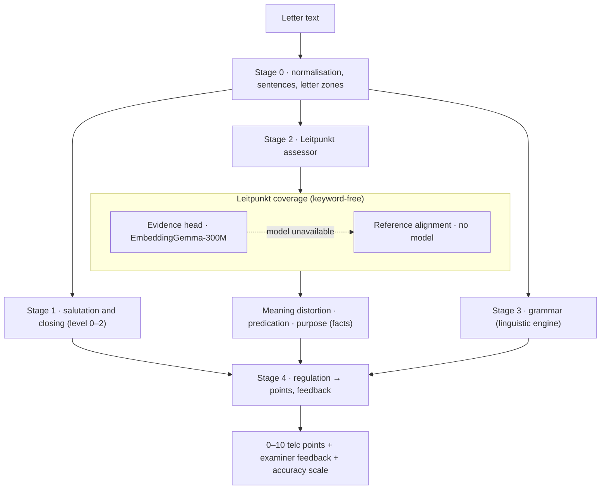

# Schreiben grading

[← Architecture overview](../../ARCHITECTURE.md) · [Linguistic engine →](linguistic-engine.md)

How a Schreiben Teil 2 letter becomes official telc points and feedback. Everything runs in the browser. Code: `src/services/schreiben/`.

**Contents:** [Pipeline](#pipeline) · [Level context](#level-context-and-ports) · [Leitpunkt coverage](#leitpunkt-coverage) · [Grading policy](#grading-policy-irankerpolicy) · [Regulation](#exam-regulation-ischreibenregulation) · [Feedback](#feedback) · [Linguistic accuracy scale](#linguistic-accuracy-scale) · [Runtime modes](#runtime-modes) · [Known limits](#known-limits)

---

## Pipeline

| Stage | Modules | Output |
|---|---|---|
| 0 | `grading/stage0Preprocessing.js`, `linguistic/macroSegmenter.js` | sentences, letter zones (salutation / body / closing) |
| 1 | `grading/stage1SalutationClosing.js`, `salutationAnalyzer.js`, `closingAnalyzer.js` | Anrede and Gruß levels |
| 2 | a Leitpunkt assessor (`grading/assessors/`, port `ILeitpunktAssessor`): `evidence-head`, without the model `reference-alignment` | level 0/1/2 per Leitpunkt, the span it was read from, unit readings, the letter's purpose |
| 2b | `grading/meaningDistortion.js`, `grading/letterContentFacts.js` | distortion per Leitpunkt, `{ hasPredication, servesTaskPurpose }` |
| 3 | `grading/grammarErrors.collectPipelineGrammarErrors` → [linguistic engine](linguistic-engine.md) | grammar errors (feedback only) |
| 4 | `regulations/`, `grading/pipelineFeedback.js` | points, examiner feedback descriptor (rendered in the UI language) |

**Entry point:** `gradingPipeline.gradeSchreibenSubmission`, the only grading path. The letter is graded at submission: `localDataService.submitLocalExamAnswers` gives the exam evaluator (`evaluation/examEvaluator.evaluateExamSubmission`) the `gradeEssay` port `grading/essayGrader.gradeEssayWithActiveProvider`, which asks the registry for the provider — the model-backed one (`micro_ranker`) whenever it is available — and grades in the Web Worker (`grading/gradingWorkerClient.gradeSchreibenWithWorker`). The provider is chosen on the main thread, where the `telc_ai_provider_override` in localStorage is readable, and reaches the worker only as the fact `forceLimitedMode`; inside the worker it counts as available (`WorkerGlobalScope`). The worker is terminated after every grading; its timeout counts idle time between progress messages, so the first model download is not cut off. Without `Worker` the pipeline runs directly; if the worker fails or times out, the letter is graded again on the main thread in the limited mode and the result names the failure (`grading_fallback`, below). The saved attempt keeps the full result with `provider_id`, so history, the exam total and the results screen show one grade; the results screen (`useSchreibenAiChecker`) grades again only attempts saved without a provider (`needsPipelineGrading`). The result also states how the letter was actually graded, `grading_mode` (`GRADING_MODES` in `ai/types.js`): `ranker` when the evidence head read the letter with the model (the Stage 2 fact `modelUsed`), `ranker_without_model` when the model was chosen but gave no vectors (offline before the download, a WebGPU/WASM failure) and the letter was read by reference alignment, `limited` in the limited mode. Why a grading fell back is the named fact `grading_fallback` (`{ reason, detail }`, `GRADING_FALLBACK_REASONS` in `ai/types.js`), `null` when it did not: `model_failed` — the Stage 2 fact `modelFailureDetail`, the message of the first embedding or model-load failure; `worker_failed` — the worker's error or idle timeout (`gradingWorkerClient.gradeSchreibenWithWorker`); `leitpunkte_unreadable` — not even reference alignment could run (the task's phrases did not load): the Leitpunkte get no points yet and the result names no provider, so the results screen grades the letter again; a submission never fails on it. `detail` is the failure's own message, never a guess from it, and it travels in the result because the production build drops `console` calls (`drop_console`). The saved attempt keeps it; the results screen shows it beside the score (`SchreibenGradingFallbackNotice`), details closed. `is_limited_mode` is true unless the mode is `ranker`; the results screen names the mode (`SchreibenAiControlBar`), attempts saved before it was recorded show no label. Grading progress is the DTO `{ stage, fraction, loadedBytes? }` (`GRADING_STAGES` in `ai/types.js`), posted by the worker as is and passed by `submitLocalExamAnswers({ onProgress })` to the exam session (`gradingProgress`). Stage 2 loads the embedding model first (`embeddingService.loadEmbeddingModel`); on the first grading the download is reported as `model_download` with the loaded bytes (`embeddings/modelDownloadProgress`: the sum over the model files, once per megabyte), and the submit and time-up dialogs show it (`GradingProgressNote`). transformers.js reports reading cached weights with the same progress events as a download, and every grading's fresh worker reads them again, so the download is reported only when the weight files are missing from its Cache Storage (`embeddings/modelCacheProbe.areModelFilesCached`, keyed by the remote URL as transformers.js stores them).

Every entry point first awaits the lexicon data (`levelContext.lexicon.load()`), because the noun and verb dictionaries are a lazily loaded asset.

## Level context and ports

- A task declares its CEFR `level` in the seed (`level: 'A1'`). `taskLevel.resolveTaskLevel` maps it; a task without a level is legacy data (stored attempts, old links) and counts as A1; an unregistered level throws `RangeError` (fail fast, no silent A1 fallback).
- `levelContext.resolveLevelContext(level)` → `{ level, policy, lexicon, grammar }` is the one place that binds a level to its grading policy, lexicon port and grammar checker. Entry points resolve it and pass it down; engine functions have no level default (`grading/levelPorts.requireLevelPort` fails fast).
- Level-free engine is enforced by `scripts/contracts/levelFreeEngineContract.js`: no level reference outside `grading/policies/`, `profiles/`, `regulations/`, `linguistic/a1LexiconService.js`.
- Accepted deviations (review 2026-09-28): the A1 lexicon (`a1Lexicon.json`, `a1LexiconService.js`) lies in `linguistic/` but only the profile and the policy import it; small parser word sets (connectors, prepositions, role markers) stay next to the detector that parses them.

## Leitpunkt coverage

**Rubric data.** Each Leitpunkt in the seed rubric (`options_json.rubric.leitpunkte_criteria`) has an `id`, a `label`, optional declared `aspects: [{ label }]` for a compound point ("Preis und Haustiere"; a conjunction in a label decides nothing), and optional meaning rules (`semantic_slots`, `conversive_rules`). `scripts/contracts/rubricContract.js` checks them, the task `level` and `addresseeRegister`. The words of a task live in its **reference phrases**, written from the task only, never from graded letters: the example bank (`src/data/exams/example-bank/<task>.json`: per unit fulfilling phrases and near misses, phrases of other purposes, prototype letters on and off the task) and `schreiben-leitpunkt-examples.json`. A task the engine grades must have them; an evaluation task may carry them itself (`options_json.evidenceBank`).

**Evidence head** (`grading/assessors/evidenceHeadAssessor.js`, `grading/evidenceHead/`), the default:
- A unit is a Leitpunkt or a declared aspect. One softmax head (F / C / I, level data `policies/a1EvidenceHead.json`, `IRankerPolicy.evidenceHead`) reads nine cosine features of every letter span — sentences, clauses, adjacent pairs — against the unit's fulfilling phrases and near misses, the other Leitpunkte's phrases, other purposes and neutral phrases, and a description from the task text. A unit's level comes from its best support; a point with declared aspects is full only when every aspect is, partial when one is. The shipped A1 thresholds (full = partial = 0.50, contradiction 9) leave a simple point no partial band and switch the whole-sentence contradiction override off: the threshold search chose them.
- The letter's purpose is read against the task's prototype letters on and off the task (`servesTaskPurpose`; `null` when a task has none).
- Vectors: the model's `sentence_embedding`, all dimensions, document prompt `title: none | text:` (`embeddingService.computeFullDocumentVector`). Reference phrases are precomputed per task as int16 (`data/exams/evidence-head/<task>.json`, `scripts/eval/evidence-head/buildReferences.mjs`), one lazy chunk per task, precached for offline grading; a test fails when they are stale against the rubric or phrases. Letter and reference vectors of different dimensions are a model failure.
- Training (`scripts/eval/evidence-head/train.mjs`) uses model-written teacher sentences (`teacher/`) and the calibration sentences, never evaluation letters; `--loto` holds each task out. Open and calibration numbers are in-sample; hidden and MERLIN are not.

**Reference alignment** (`grading/assessors/referenceAlignmentAssessor.js`, `grading/referenceAlignment/`), when the model is not there (limited mode, a model failure): each sentence and clause is tokenised to lemmas and slots and aligned with the same reference phrases (IDF-weighted coverage of a phrase by the span). Thresholds and IDF are level data (`policies/a1ReferenceAlignment.json`), calibrated from the phrases alone (`calibrateAlignment.mjs`). It reads no purpose.

**Facts beside the levels:**
- **Meaning distortion** (`grading/meaningDistortion.js` over `linguistic/semanticFrameValidator.js`): the spans a credited Leitpunkt was read from, its own and its aspects', checked against the rubric's `semantic_slots` / `conversive_rules` ("Wie viel kostet mein Sohn?", "vermieten" for "mieten"). A noun phrase after a preposition is no slot ("die Wohnung für meine Frau"). Every person noun of the lexicon has the category `person`.
- **Content facts** (`grading/letterContentFacts.js`): `{ hasPredication, servesTaskPurpose }`. A noun list states nothing; a question ("Helm auch?") or an elliptical predicate ("Leider krank.") does.
- **Unassigned sentences** (`grading/unassignedSentences.js`): body sentences no credited span overlaps; debugging only.

## Grading policy (`IRankerPolicy`)

`grading/policies/rankerPolicyInterface.js`; registry `grading/policies/index.js` (`getRankerPolicy(level)`); A1: `a1RankerPolicy.js`. The level data the engine is given: `lexicon`, `evidenceHead`, `referenceAlignment`, `feedbackSelection`, `buildExaminerFeedback(facts)`. Points are not decided here.

## Exam regulation (`ISchreibenRegulation`)

`regulations/schreibenRegulationInterface.js`; registry `regulations/index.js` (`getSchreibenRegulation`, `registerSchreibenRegulation`, `scoreCriteriaLevels`); A1: `regulations/telcA1Regulation.js` per `reglament/telc-a1.md` (Teil 1 — Formular, §6).

Decides **what the facts are worth**. Contract: `id`, `level`, `maxPoints`, `trainingPassMark`, `acceptsTeil1Answer(facts)`, `scoreTeil2(evidence)`; evidence = `{ leitpunktLevels, distortedLeitpunkte, anrede, gruss, grammarErrors, wordCount, isUnratable, content }`.

Teil 1 (form fields): `schreibenTeil1Evaluator.js` compares the answer, and each run of its words, with every accepted answer (`schreibenFormAnswerFacts.js` → `FormAnswerFacts` = `{ sameText, sameNumberOrDate, numberAnswer, rivalWords, abbreviation, singleWord, shorterLength, editDistance, sameSound }`) and asks the regulation of `question.level`. `numberAnswer` (a digit or a number word other than the article "eine", in the compared answer or expected word) and `rivalWords` (two different months or weekdays, from `linguistic/data/calendarWords.json` and `clauseWordClasses.json`) rule out any typo or sound tolerance: a number counts only "eindeutig richtig", and "Juni" for "Juli" is another answer, not a misspelling. The expected answer decides how numbers are read: a date (`schreibenDateNormalizer.js`: spaces, month abbreviations from `calendarWords.json`, a leading word "am 18.7." that must agree — "Montag, 18. Juli" ≠ "Freitag, 18. Juli", "Juli 18", the year only after a dot or a space so "1.500" is a number, and when both write it; day and month never swap), a time, compared as a whole and never word by word (`schreibenTimeNormalizer.js`: "14:00" = "14 Uhr" = "um 14"; a part of the day puts the hour on its half of the clock by the hours it spans in `calendarWords.json` `dayParts`, so "abends um 8" = "20 Uhr" and "abends um 9" ≠ "9 Uhr"; no other number; words may be added only when the answer marks a time by "Uhr", a clock or a part of the day from `calendarWords.json`: "morgens um 9" = "9 Uhr", but "halb 9", "9 Euro" ≠ "9 Uhr"); a written year, wherever the date stands in the answer, is checked against the expected forms that write one, a digit sequence such as a phone number (`schreibenNumberNormalizer.js`: the same digits however grouped), or an amount. Tokens come from `schreibenNumberTokens.js` (thousands dot, decimal comma, a decimal dot before a currency, house number "5a", unit symbols and fractions from `numberWords.json`). In an amount a word binds to the number before it, or, with no word after the last number, to the one after it ("Erwachsene: 2"); counted words compare by Snowball stem ("4 Person" = "4 Personen"), fillers (`functionWords.json` `quantityFillers`: um, ca., und) are left out, and no word may be lost. A note in brackets is not graded ("3 (drei)"), unless it offers another answer (`functionWords.json` `alternativeMarkers`: "18. Juli (oder 19. Juli)"); the answer is also read with its brackets opened ("(030) 123456"). An answer that writes another number beside the right one does not count ("18. Juni oder 18. Juli"). `rivalWords` also holds when the answer sounds like, or is nearer to, another month or weekday ("Sontag" for Montag); `abbreviation` is a usual abbreviation from `linguistic/data/abbreviations.json` ("Poststr.", "Do."). Numbers compare every number with the words it counts, in any order, so "ein Erwachsener und zwei Kinder" = "2 Kinder und 1 Erwachsener", but "zwei Kinder" ≠ "2 Kinder und 1 Erwachsener". `sameSound` compares German sound keys (`linguistic/germanSoundKey.js`, rules in `linguistic/data/germanSpellingSounds.json`): spelling-to-sound rules that keep the vowels and the marked vowel length, so "donastag" = Donnerstag but Dienstag ≠ Donnerstag and Miete ≠ Mitte. Kölner Phonetik (`cologne-phonetic`, `talisman`) was rejected: it drops the vowels and gives Dienstag and "donastag" one code; Phonem does not vocalise r; `double-metaphone` is English.

telc A1 Teil 1: an answer that names a choice ("Montag oder Donnerstag", markers in `functionWords.alternativeMarkers`) is not unambiguous and counts for nothing, the evaluator passes it to the regulation as `offersAlternative`; the same text, an umlaut transliteration or the same number/date counts; numbers only exactly, with the same words beside them ("ein Jahr" = "1 Jahr", "ein Monat" ≠ "1 Jahr"), while a word beside a number keeps its tolerance ("Hauptstrase 5" = "Hauptstraße 5"; "18. Juni" ≠ "18. Juli" through `rivalWords`); one typo from 4 letters, two from 8, or the same sound key — for a single word only: a phrase is compared word by word, so "am Sonntag" ≠ "am Montag".

telc A1 Teil 2:
- each Leitpunkt 3 / 1.5 / 0; Kommunikative Gestaltung (Anrede + Gruß) 1 / 0.5 / 0; max 10;
- the formulas are rated against the register the task declares, `rubric.addresseeRegister` (`formal` | `informal`, `letterRegister.js`, required by `rubricContract`; a task without a rubric is formal): "Lieber Ingo … Viele Grüße" fits a letter to a friend, not one to an office;
- a distorted but understandable Leitpunkt is at most partial (1.5); no predication, or a letter written for another purpose (`servesTaskPurpose === false`) → every Leitpunkt 0 (`leitpunkteVoidReason`: `NO_PREDICATION`, `OFF_TOPIC`); a purpose that was not read voids nothing; gibberish/empty → 0;
- grammar, spelling and length are **not** criteria; a declension slip in a correct formula ("Sehr geehrte Herr") keeps the point and becomes a hint.

Result shape: `breakdown.items[i].points/maxPoints` (detector level kept in `detectedScore`), `breakdown.leitpunkte`, `breakdown.kommunikative_gestaltung`, `breakdown.leitpunkte_void_reason`, `criteria_breakdown` (levels + `kg` + `scale`). Saved attempts store levels and are re-scored on the current scale when opened (the self-check UI uses the same `scoreCriteriaLevels`).

**Adding a level:** `reglament/<level>.md` → regulation + grading policy + reference phrases and a trained head + grammar profile → register → regression suite. A1 code stays untouched.

## Feedback

- **Diagnostic codes** (`feedback/feedbackContracts.js`): `LP_FULFILLED`, `LP_PARTIAL`, `LP_MISSING`, `LP_FRAME_VIOLATION` (a distorted point), `ANREDE_*`, `GRUSS_*`, …; a compound point that misses an aspect (unit level 0) gets `LP_MISSING_ASPECT`. The `LP_INVERTED_*` codes and phrases stay only for attempts saved before the keyword-free engine.
- **Examiner feedback**: `IRankerPolicy.buildExaminerFeedback(facts)` → language-neutral `examiner_feedback = { version, summary: [{code, params}], bullets: [...] }` (`feedback/examinerFeedbackBuilder.js`). Params hold only verbatim quotes of the letter and rubric labels. Grammar highlights are picked by error `code`/`category` (`grammarHighlightSelector.js`). Rendered **at display time** in the UI language (`examinerFeedbackRenderer.js`, `examinerPhraseBank.js`), so stored attempts re-render after a language switch. The summary names a void reason and never quotes against a 0.
- **Tutor notes** (`feedback/tutorFeedbackResolver.js`): one sentence per criterion in ru/en/de.
- UI: `results/schreiben/*` — `SchreibenSelfCheck` (conclusion → criteria → texts with credited phrases highlighted via `utils/letterHighlights.js` → details), `SchreibenExaminerFeedbackCard`, `SchreibenRankerDetailsCard` only with `?debug` (each point's span and its units' readings, labelled by the engine that read them).

## Linguistic accuracy scale

A pedagogical 0–10 score **independent of the telc score** (`scoring/linguisticAccuracyScorer.js`, UI `LinguisticAccuracyPanel.jsx`, labelled as not affecting the result):
- defects deduplicated across analyzers (`linguistic/grammarErrorDeduper.js`, in `mergeCandidateGrammarErrors`);
- misspelt words count (`linguistic/letterRules/misspellingRule.js`: unknown to the lexicon and sounding like exactly one A1 word; capitalised words inside a sentence may be names and are skipped);
- weighted by category from the grammar profile's `accuracyWeights` (A1: syntax 2.0, case/agreement/grammar/lexis 1.5, spelling 0.5; bands from 9 / 8 / 6);
- normalised per 30 words of the letter body (`scoring/letterBodyWordCounter.js`); not rated when no Leitpunkt is covered.

## Runtime modes

Capability is detected at run time, never by user agent: the embedder picks WebGPU only when `navigator.gpu.requestAdapter()` grants an adapter (`utils/webGpuSupport.isWebGPUAdapterAvailable`, on the main thread and in the worker), otherwise WASM. A software fallback adapter (`adapter.info.isFallbackAdapter`, e.g. SwiftShader) counts as no adapter: on SwiftShader (headless Chromium) the model did not finish within 100 s, the WASM path took about 4 s. The ONNX runtime comes from the app's own files, never a CDN: `embeddings/ortRuntimeAssets.pointOrtToOwnAssets` sets `wasmPaths` per device — the asyncify build for WebGPU, the plain `ort-wasm-simd-threaded` build for WASM (observed on onnxruntime-web 1.26.0-dev.20260416: asyncify has no CPU kernel for the q4 model's `GatherBlockQuantized`, no session is created on it). Transformers.js points them at jsdelivr by default.

| Environment | Embeddings | Mode |
|---|---|---|
| WebGPU available | Transformers.js WebGPU, EmbeddingGemma 300M q4 | evidence head |
| No WebGPU | Transformers.js Wasm | evidence head (Wasm) |
| Model unavailable | — | limited mode: reference alignment |

The primary provider is set in `src/config/aiConfig.js` (`PRIMARY_PROVIDER`); a developer override via `localStorage` (`telc_ai_provider_override`, e.g. `none`) forces a registered provider.

## Known limits

Recorded instead of fitting (CLAUDE.md §8.1):
- **Refusals and inversions** are read only from the reference phrases' near misses: "Ich frage nicht nach Kosten", "die Heizung funktioniert perfekt … keinen Handwerker" can still earn the point, with the model too (the contradiction override is off by the shipped thresholds). Reference alignment hardly weighs a negation: a negated near miss can outrank a fulfilling phrase ("ich möchte im August einen Deutschkurs machen" → Leitpunkt 1 = 0 without the model). A polarity-agreement rule was measured (open 5 fixed / 1 broken, calibration 8 / 14) and not introduced.
- Without the model no letter is voided as off topic (no purpose reading); a word-alignment purpose rule caught 18 of 39 off-topic letters and voided 7 of 141 on-topic ones, and was not introduced.
- The recorded expectations the engine does not meet yet are `todo` tests (`tests/helpers/h2Regressions.js`).
- Teil 1: the one-typo tolerance also accepts another real word at distance 1 ("Mitte" for Miete; another month or weekday is not taken: "Sontag" for Montag is 0); a final "ch" counts as a final "g" (the regulation's "Donerstach") only against one expected word.
- a month alone ("im August") counts as a Zeitraum until a regulation source says otherwise.

Grammar limits: see [linguistic engine](linguistic-engine.md#known-limits).
